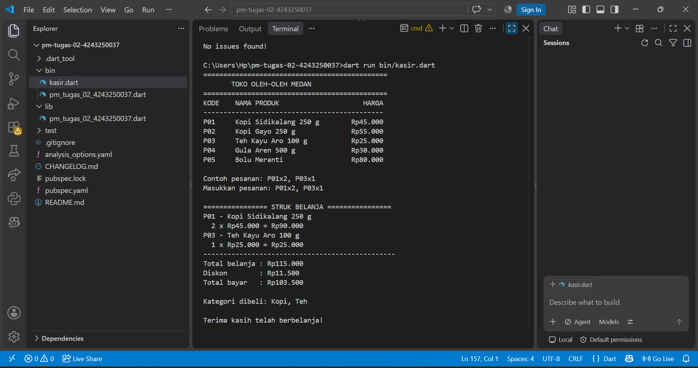
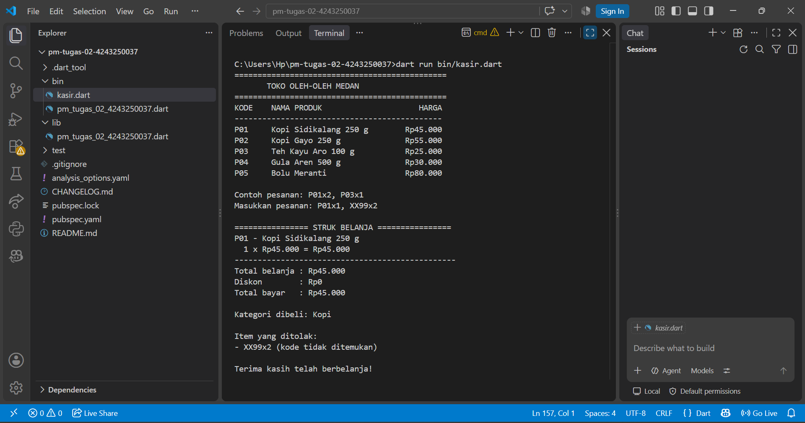

# Tugas Rutin 2 — Aplikasi Console Kasir Sederhana

## 1. Identitas Mahasiswa

- **Nama:** Lastri P. Silaban
- **NIM:** 4243250037
- **Program Studi:** Ilmu Komputer
- **Mata Kuliah:** Pemrograman Mobile

## 2. Deskripsi Program

Aplikasi Console Kasir Sederhana merupakan program Dart untuk membantu proses transaksi pada toko oleh-oleh di Medan. Program menampilkan katalog produk, menerima pesanan melalui terminal, menghitung total belanja, memberikan diskon 10% apabila total belanja mencapai minimal Rp100.000, dan mencetak struk transaksi.

Program juga memvalidasi kode produk dan jumlah barang agar pesanan yang tidak valid dapat ditolak tanpa menghentikan program.

## 3. Screenshot Pengujian

### Skenario 1 — Pesanan Valid

### Skenario 2 — Kode Produk Tidak Valid

## 4. Penjelasan Konsep Dart

Dalam Dart, `var` digunakan untuk mendeklarasikan variabel dengan tipe data yang disimpulkan secara otomatis oleh Dart. Konsep ini tidak digunakan secara langsung dalam deklarasi variabel pada program ini. `final` digunakan untuk variabel yang hanya dapat diberi nilai satu kali, seperti `input`, `total`, dan `totalBayar` dalam file `bin/kasir.dart`. Sementara itu, `const` digunakan untuk nilai konstan yang sudah diketahui saat kompilasi. Contohnya adalah `batasDiskon` dan `persentaseDiskon` yang dideklarasikan di bagian awal file.

Null safety membantu menangani nilai yang mungkin kosong atau tidak tersedia. Pada bagian input, `stdin.readLineSync() ?? ''` memberikan string kosong jika input bernilai `null`. Pada bagian pencarian produk, kondisi `produk == null` memeriksa apakah kode produk ditemukan sebelum datanya digunakan. Selain itu, `int.tryParse()` menghasilkan nilai `null` jika jumlah barang tidak dapat dikonversi menjadi bilangan bulat. Hasil tersebut diperiksa sebelum digunakan dalam perhitungan subtotal, sehingga input yang tidak valid dapat ditolak dengan aman.

## 5. Penggunaan AI

AI digunakan sebagai alat bantu untuk memahami instruksi tugas, menyusun dan meninjau kode, serta membantu pengujian program. Kode akhir dipelajari dan diuji kembali oleh mahasiswa.